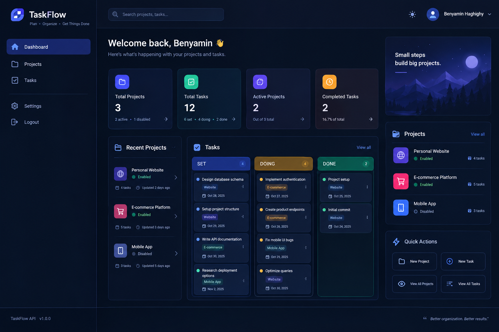
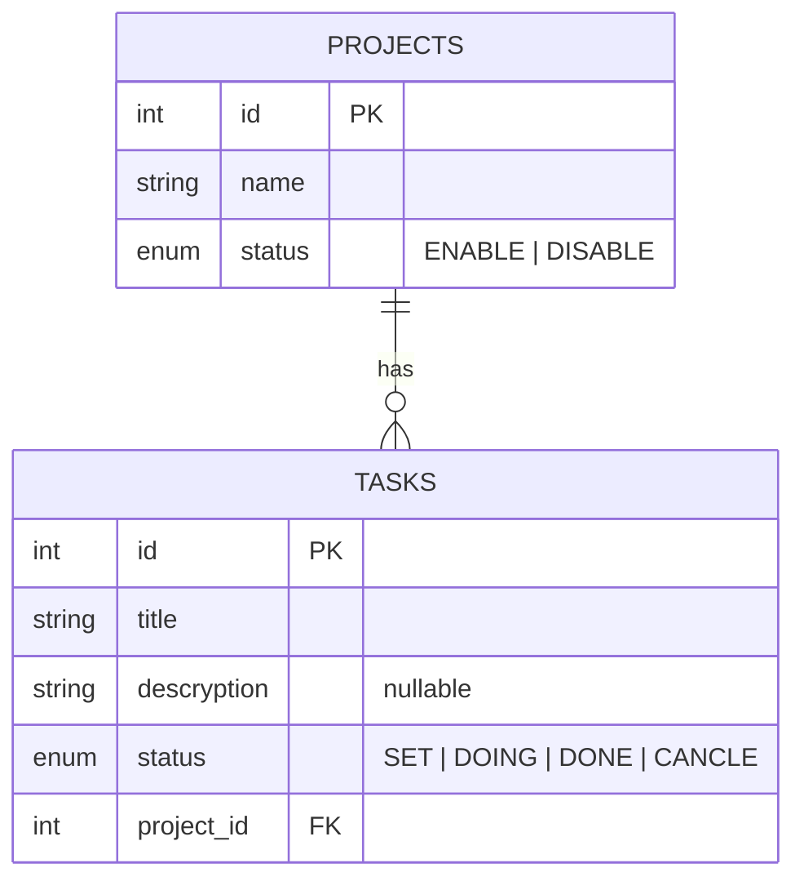

<p align="center">
  
</p>

# TaskFlow API

A REST API for managing projects and the tasks inside them, built with **NestJS**, **TypeORM** and **PostgreSQL**.

I built it while learning NestJS to practice the things almost every backend job needs: a relational schema, request validation, pagination, filtering and consistent error handling.

## Features

- CRUD for **projects** and **tasks**
- One-to-many relation: a project has many tasks, and every task belongs to a project
- Request validation with DTOs (`class-validator`) and a global `ValidationPipe` (`whitelist` and `transform` enabled)
- Pagination (`page`, `limit`) on list endpoints
- Filtering by status (`ENABLE` / `DISABLE` for projects, `SET` / `DOING` / `DONE` / `CANCLE` for tasks)
- Status values are enforced twice: by validation in the API and by a real `enum` type in PostgreSQL
- Project checks before writing: creating or moving a task to a project that does not exist returns `404` instead of a database error
- Responses share one shape: `{ statusCode, data, message }`

## Tech stack

| Layer | Tools |
|---|---|
| Framework | NestJS |
| Language | TypeScript |
| Database | PostgreSQL |
| ORM | TypeORM |
| Validation | class-validator, class-transformer |
| Lint / format | oxlint, Prettier |

## Data model



## Getting started

### Requirements

- Node.js (LTS)
- A running PostgreSQL instance

### Install and run

```bash
git clone <your-repo-url>
cd <your-repo-folder>
npm install

# create the database first
createdb myproject

# set your database credentials in src/app.module.ts, then:
npm run start:dev
```

The server starts on `http://localhost:3000` (or the port in the `PORT` environment variable).

Tables are created automatically on startup (`synchronize: true`). That is fine for local development; for production this should be replaced with migrations.

## API

### Projects

| Method | Endpoint | Description |
|---|---|---|
| `POST` | `/projects` | Create a project |
| `GET` | `/projects/status` | List projects with their tasks (paginated) |
| `GET` | `/projects/status/:status` | Same, filtered by `ENABLE` or `DISABLE` |
| `GET` | `/projects/:id` | Get one project with its tasks |
| `PATCH` | `/projects/:id` | Rename a project |
| `DELETE` | `/projects/:id` | Delete a project |

### Tasks

| Method | Endpoint | Description |
|---|---|---|
| `POST` | `/tasks` | Create a task inside a project |
| `GET` | `/tasks` | List tasks with their project (paginated) |
| `GET` | `/tasks/status/:status` | Filter by `SET`, `DOING`, `DONE` or `CANCLE` |
| `GET` | `/tasks/:id` | Get one task |
| `PATCH` | `/tasks/:id` | Update a task |
| `DELETE` | `/tasks/:id` | Delete a task |

Pagination uses query parameters, for example:

```
GET /tasks?page=2&limit=5
```

Defaults are `page=1` and `limit=10`.

### Examples

Create a project:

```http
POST /projects
Content-Type: application/json

{ "name": "Portfolio website" }
```

Create a task in that project:

```http
POST /tasks
Content-Type: application/json

{
  "title": "Design the landing page",
  "descryption": "Wireframe first, then build it",
  "status": "DOING",
  "project_id": 1
}
```

Invalid input is rejected before it reaches the service:

```http
POST /tasks
{ "title": "ab", "project_id": 0 }
```

returns `400 Bad Request` (title too short, `project_id` must be at least 1).

## Project structure

```
src/
├── main.ts                 # bootstrap and global ValidationPipe
├── app.module.ts           # database connection and module wiring
├── projects/
│   ├── dto/                # create / update / pagination DTOs
│   ├── entities/           # Project entity
│   ├── enums/              # StatusProject
│   ├── projects.controller.ts
│   ├── projects.service.ts
│   └── projects.module.ts
└── tasks/
    ├── dto/
    ├── entities/           # Task entity (ManyToOne -> Project)
    ├── enums/              # StatusTasks
    ├── tasks.controller.ts
    ├── tasks.service.ts
    └── tasks.module.ts
```

## Roadmap

Things I know are missing and plan to add next:

- [ ] Move database settings to environment variables
- [ ] Replace `synchronize` with TypeORM migrations
- [ ] Return the real total count in paginated responses
- [ ] Decide what happens to a project's tasks when the project is deleted
- [ ] Unit and e2e tests
- [ ] Swagger documentation
- [ ] Docker Compose for the app and PostgreSQL
- [ ] Authentication

## Author

**Benyamin Haghighy** · [GitHub](https://github.com/benyamin-haghighy)
